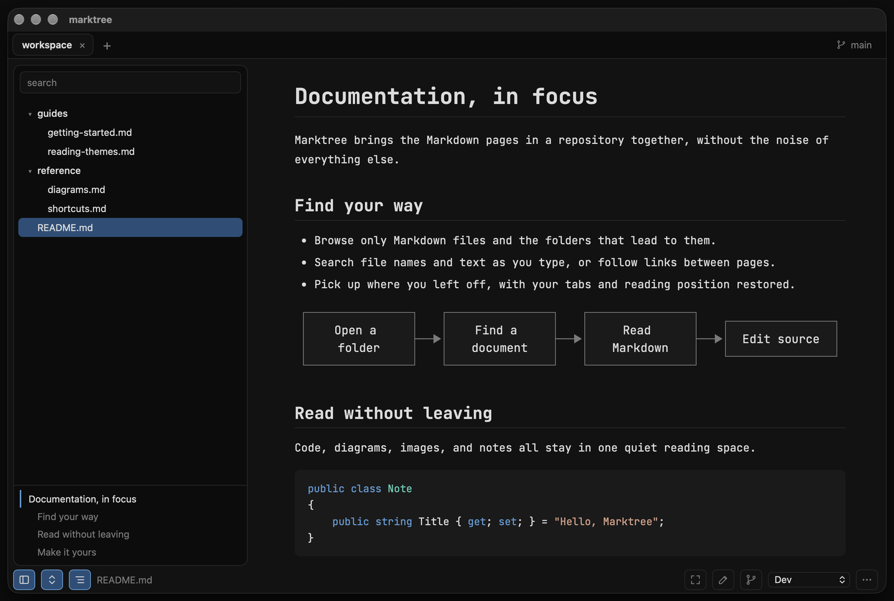

<p align="center"></p>

# marktree

A quiet reading space for Markdown documentation across folders and repositories on macOS and Windows.



## Features

- Find Markdown in large folders: the tree shows only relevant files and folders, with optional Git-ignore filtering.
- Search file names and text as you type; matches are marked in the open document.
- Keep multiple folders open in tabs; each tab and every restart returns to the document and position where you left off.
- Open folders and Markdown files by dropping them on the window or with `marktree <folder or file>`; a running marktree takes them over.
- Read images, Mermaid diagrams, and highlighted code with reading themes and zoom, plus GitHub alerts, footnotes, and emoji. Front matter stays folded away, and code copies with one click.
- Follow long documents with an outline of their headings.
- Read in full screen: arrow keys turn to the next document in the folder or jump between chapters.
- Make a theme your own: export it from the theme list as a CSS file, change it, and import it as a custom theme.
- Edit Markdown source; changes save when you leave the editor, while external file changes appear automatically.

## Keyboard shortcuts

| Shortcut | Action |
|---|---|
| Ctrl/⌘+O | Open a folder |
| Ctrl/⌘+P | Search file names and text |
| Ctrl/⌘+F | Find in the document, Enter and Shift+Enter for the next or previous match |
| Ctrl/⌘+B | Show or hide the sidebar |
| Ctrl/⌘+J | Show or hide the outline |
| Ctrl/⌘+E | Edit the source, or back to the preview |
| Ctrl/⌘+S | Save |
| Ctrl/⌘+Plus, Minus, 0 or Ctrl+mouse wheel | Zoom |
| F11 (⌃⌘F on macOS) | Full screen, Esc leaves |
| ← → in full screen | Previous or next document in the folder |
| ↑ ↓ in full screen | Previous or next chapter |

## Build a portable app

Install [Node.js 22.12+](https://nodejs.org), [Rust](https://rustup.rs), and the [Tauri prerequisites](https://v2.tauri.app/start/prerequisites/) for your platform first.

### macOS

```sh
git clone https://github.com/chrismo80/marktree.git
cd marktree
npm_config_cache="$PWD/.npm-cache" npm ci
npx tauri build --bundles app
```

App: `src-tauri/target/release/bundle/macos/marktree.app`

### Windows (PowerShell)

```powershell
git clone https://github.com/chrismo80/marktree.git
cd marktree
npm ci
npx tauri build --no-bundle
```

App: `src-tauri/target/release/marktree.exe`
